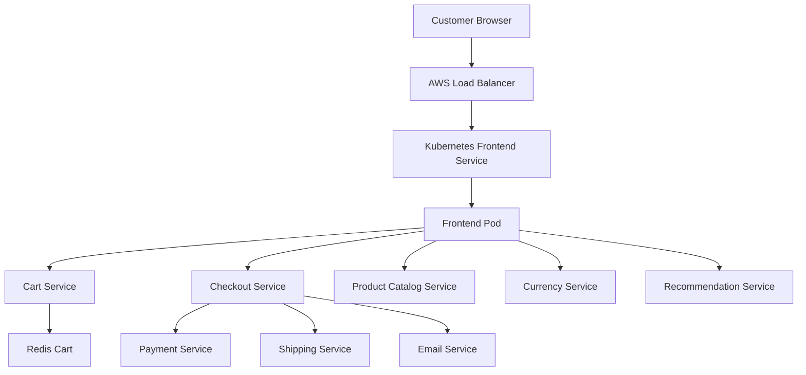

# Architecture

## Overview

This project deploys Google's Online Boutique microservices demo to Amazon EKS using Terraform and Kubernetes.

## Architecture Diagram

## How It Works

1. A customer opens the website in a browser.
2. The AWS load balancer receives the incoming request.
3. The Kubernetes frontend Service directs traffic to the frontend Pod.
4. The frontend communicates with internal microservices.
5. The microservices handle functions such as shopping carts, checkout, payments, shipping, and product information.

## Infrastructure

- **Amazon VPC:** provides the network for the AWS resources.
- **Amazon EKS:** runs the Kubernetes cluster.
- **Worker nodes:** provide computing capacity for the application Pods.
- **AWS Load Balancer:** exposes the frontend to customers.
- **Terraform:** defines and provisions the AWS infrastructure.
- **Kubernetes:** manages the application's workloads and services.
